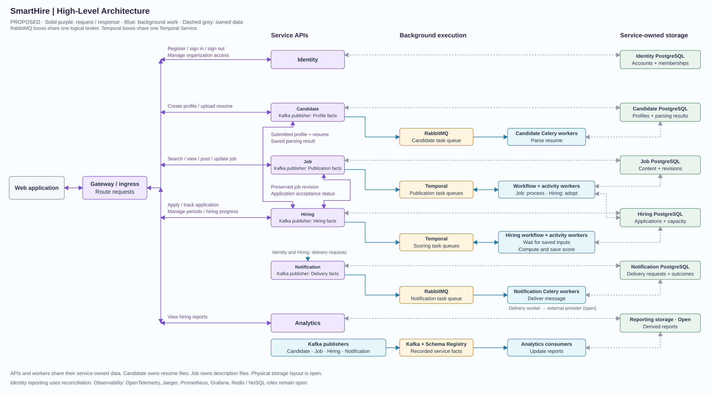

# SmartHire High-Level Architecture

**Status:** Proposed

**Purpose:** Show how APIs, workers, messaging and storage run together.

## Component View

[Full-size SVG](diagrams/architecture/smarthire-architecture.svg)

Purple arrows show requests. Blue arrows show background work and facts. Dashed lines show selected data and telemetry connections.
This is the target system, not the current implementation. Service ownership is defined in [ADR 0002](../adrs/0002-service-boundaries.md).

## Runtime Roles

| Component | Responsibility |
| --- | --- |
| API entry point and FastAPI services | Route requests and execute the responsible service's business rules. Notification receives backend work rather than user requests. |
| Temporal and activity workers | Coordinate job publication and candidate scoring. Job activities process content; Hiring activities adopt revisions and score preserved submissions once inputs are ready. |
| Celery with RabbitMQ | Run parsing workers owned by Candidate and delivery workers owned by Notification. |
| Kafka with Schema Registry | Distribute recorded recruitment and delivery facts to Analytics. Identity facts use reconciliation in the current proposal. |
| OpenTelemetry, Jaeger, Prometheus and Grafana | Instrument operations, inspect traces, collect metrics and display operational dashboards. |

Temporal executes publication and scoring steps through activity workers. Do not also submit the same steps to Celery with competing retries.
APIs and workers can run separately while retaining the same service ownership.

## Storage Boundaries

- Use PostgreSQL for authoritative business records. Each service controls its logical storage; other services access it through the owner.
- Candidate controls resume storage; Job controls uploaded-description storage. Analytics controls derived report storage.
- Physical database layout, file storage, reporting storage and the delivery provider remain open. Redis and NoSQL responsibilities require data-access design.

## Load and Failure Containment

- Scale service API replicas and worker pools independently. Separate parsing, scoring and delivery queues and resources.
- Bound concurrency, queue growth and retries. Apply tenant limits within shared capabilities.
- Test overload and dependency failures: shared databases, brokers and service calls can still spread failures.

Docker Compose supplies local infrastructure. Production hosting and resource sizing remain open.
The [shared workflow rules](workflows/README.md#shared-execution-rules) define durability and recovery behavior.

## Remaining Design Work

1. Define current-access enforcement, including removal during an in-progress operation. A gateway or request-entry check alone is insufficient.
2. Validate the [publication handoff](workflows/job-content.md#failure-and-recovery), including interrupted revision switches.
3. Design Job and Hiring schemas and transaction boundaries. Define exact contracts and sequence diagrams as each workflow is implemented.

Update the SVG when changing the component view.
