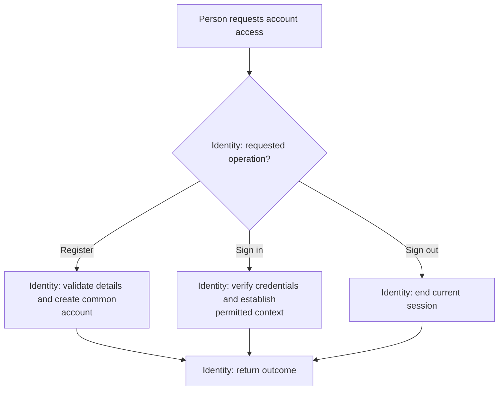

# Account Access

**Purpose:** Register an account or start and end a session.

Candidate or recruiter: `register_account`, `login`, `logout`.

## Steps

## Failure and Recovery

- Reject invalid credentials. Login must not restore removed organization access.
- Recover the original account or session outcome after a timeout. A retry must not create another account or session effect.

[Workflow index and shared execution rules](README.md)
