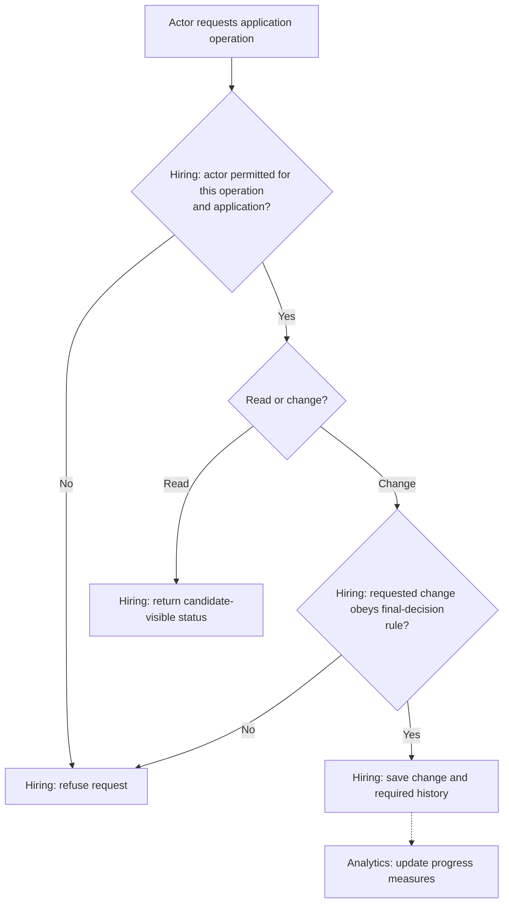

# Application Tracking and Hiring Progress

**Purpose:** Read personal application status and record recruiter actions.

Candidate: `track_application`. Recruiter or owner: `move_application_stage`, `record_interview_progress`, `record_recruiter_notes`, `record_hiring_decision`.

## Steps

## Failure and Recovery

- Save stage changes and history together, including actor and time. Retrying must not duplicate history or overwrite a final decision.
- Use the submitted stage definitions. Candidate-visible status must exclude private recruiter notes and other candidates' records.

[Workflow index and shared execution rules](README.md)
