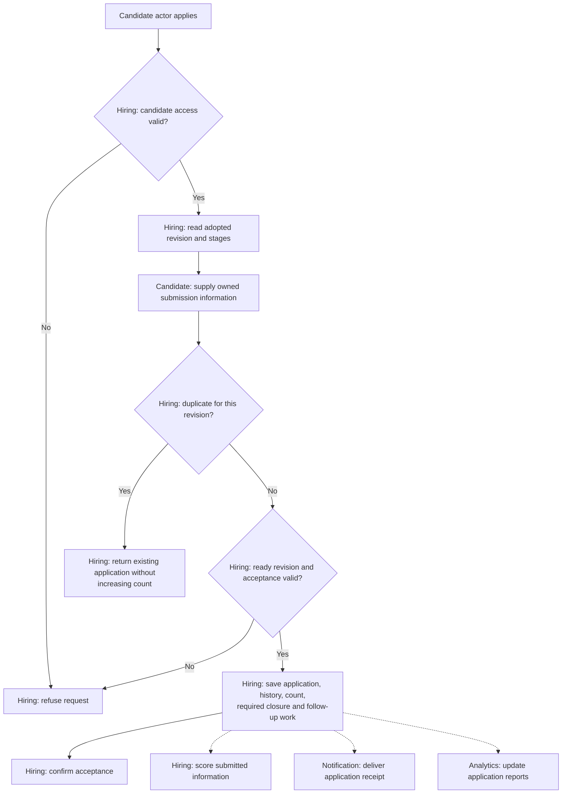

# Apply to a Job

**Purpose:** Accept an application without duplicates or exceeding capacity.

Candidate: `apply_to_job`.

## Steps

When acceptance reaches capacity, Hiring also updates Job's displayed status. Scoring follows the [evaluation workflow](candidate-evaluation.md).

## Failure and Recovery

- At save, recheck the ready adopted revision, any switch pause, period, capacity and duplicates. Save required closure with the count; earlier reads reserve nothing.
- Resume an uncertain submission from its saved outcome. A retry must not consume capacity or create follow-up work twice.
- Parsing, scoring, receipt or reporting failures must not undo acceptance or block independent follow-up work.

[Workflow index and shared execution rules](README.md)
