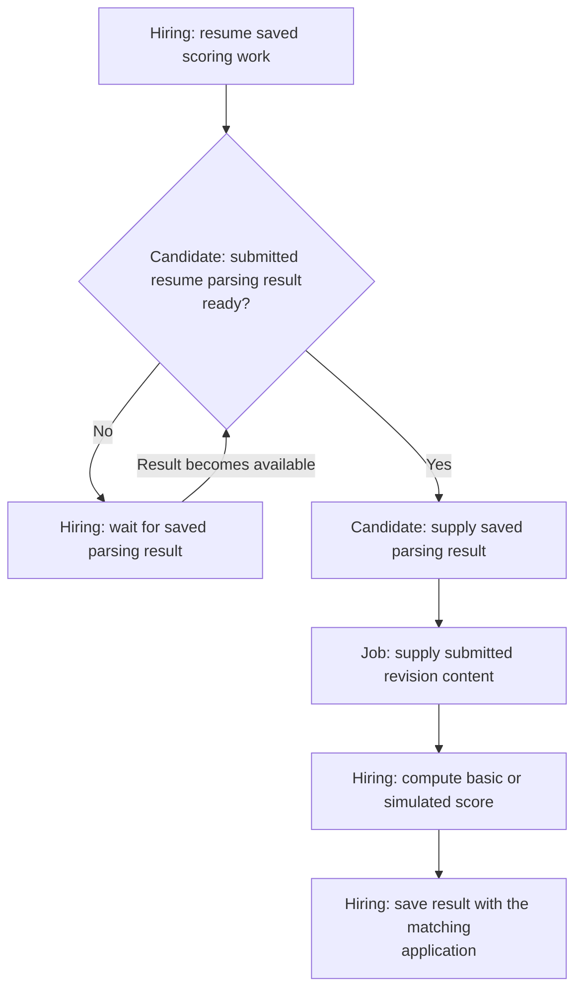

# Candidate Scoring

**Purpose:** Score an accepted application without delaying the candidate.

Automatic work owned by Hiring. Starts after application acceptance.

## Steps

## Failure and Recovery

- Use the original submitted inputs. Reuse completed scores; later profile or job changes must not replace them.
- Candidate recovers parsing failures in the [upload workflow](candidate-profile.md). Scoring waits for the saved result and never starts parsing.
- Missing inputs or scoring failure leave the application accepted. Resume unfinished scoring when its inputs become available.

[Workflow index and shared execution rules](README.md)
