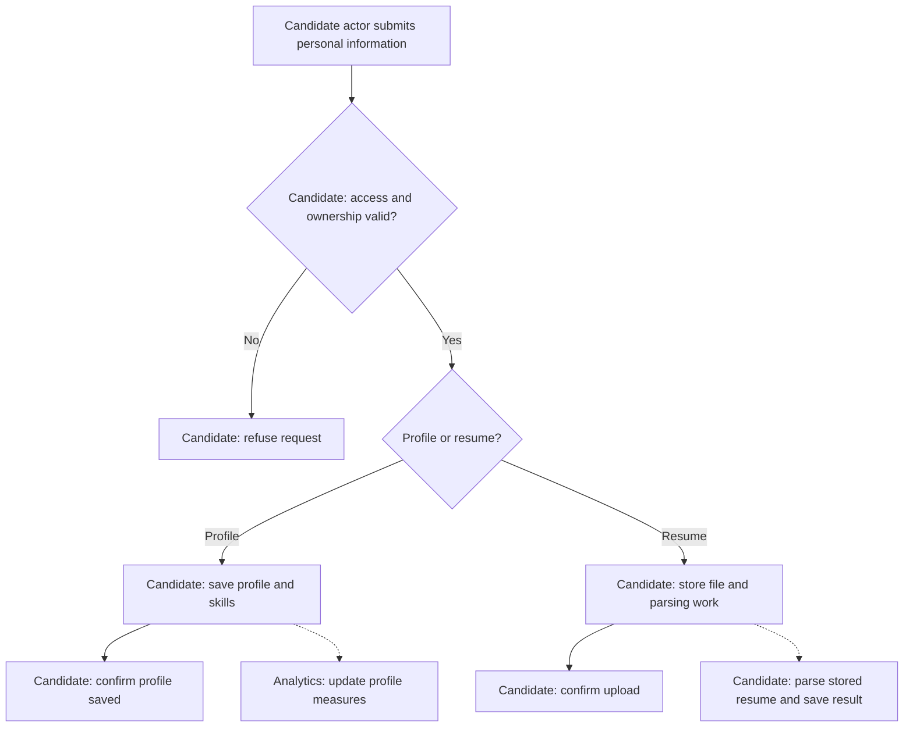

# Candidate Profile and Resume

**Purpose:** Save personal information and automatically parse uploaded resumes.

Candidate: `create_candidate_profile`, `upload_resume`.

## Steps

Hiring reads the saved parsing result in the [scoring workflow](candidate-evaluation.md). Application submission does not start parsing.

## Failure and Recovery

- Do not confirm an upload unless its file and record are durable. Reconcile partial file storage before repeating an upload.
- Parsing failure leaves the uploaded file stored. Resume parsing against that same file; preserve earlier submitted resumes.

[Workflow index and shared execution rules](README.md)
