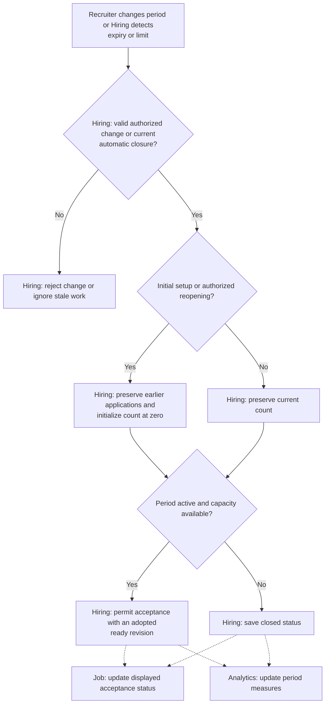

# Hiring Periods and Capacity

**Purpose:** Control when a job accepts applications.

Recruiter or owner: `configure_hiring_period`, `reopen_job`. Hiring also closes acceptance automatically.

## Steps

## Failure and Recovery

- Save period, count and acceptance status consistently with concurrent application admission.
- Failed changes must not partially reset capacity. Retrying reopening must not create another period or reset the count again.
- Ignore expiry work for an old period. A duration change must not bypass the reopening rules.

[Workflow index and shared execution rules](README.md)
