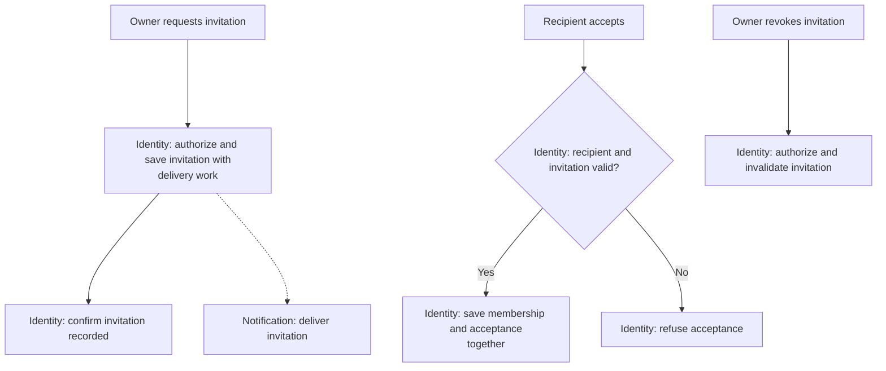

# Recruiter Invitations

**Purpose:** Invite an account and establish membership through acceptance.

Owner: `invite_recruiter`, `revoke_invitation`. Intended recipient: `accept_invitation`.

## Steps

## Failure and Recovery

- Delivery failure leaves the invitation recorded; Notification retries independently.
- Identity must order acceptance against revocation. A delivered message does not prove validity, and repeated acceptance must not duplicate membership.
- Revoking an accepted invitation does not remove an established membership.

[Workflow index and shared execution rules](README.md)
