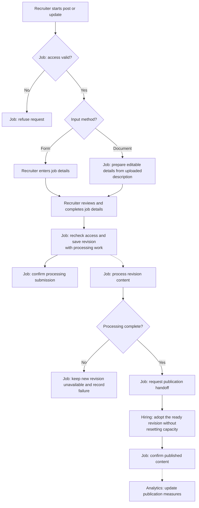

# Post or Update a Job

**Purpose:** Prepare reviewed job content and publish a processed revision.

Recruiter or owner: `post_job`, `update_job`.

## Steps

## Failure and Recovery

- Unreadable documents require correction or form entry. Reuse unchanged preparation results where possible.
- Failed processing must not replace the previous published revision. Resume unfinished work for the same submitted revision.
- Proposed handoff: Hiring prepares the switch and pauses admission. Job marks readiness; Hiring adopts the revision and clears the pause without resetting capacity.
- Lost replies resume the same switch. An abandoned pause requires reconciliation; a timeout must not silently restore an old revision.
- This handoff has no assumed cross-service transaction. Its enforcement and concurrency behavior still need validation.

[Workflow index and shared execution rules](README.md)
