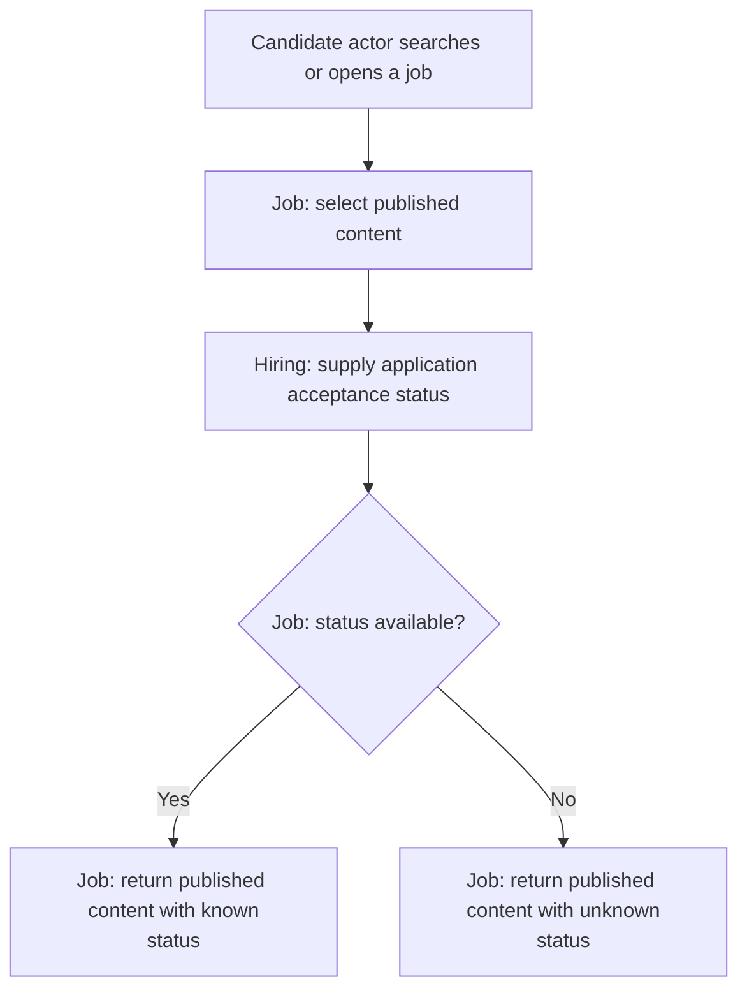

# Browse and View Jobs

**Purpose:** Return published jobs and their application acceptance status.

Candidate: `search_jobs`, `view_job`.

## Steps

## Failure and Recovery

- Public browsing need not depend on Identity. Missing Hiring status must not be presented as open acceptance.
- A displayed status reserves no capacity. Hiring checks current admission when the candidate applies.

[Workflow index and shared execution rules](README.md)
