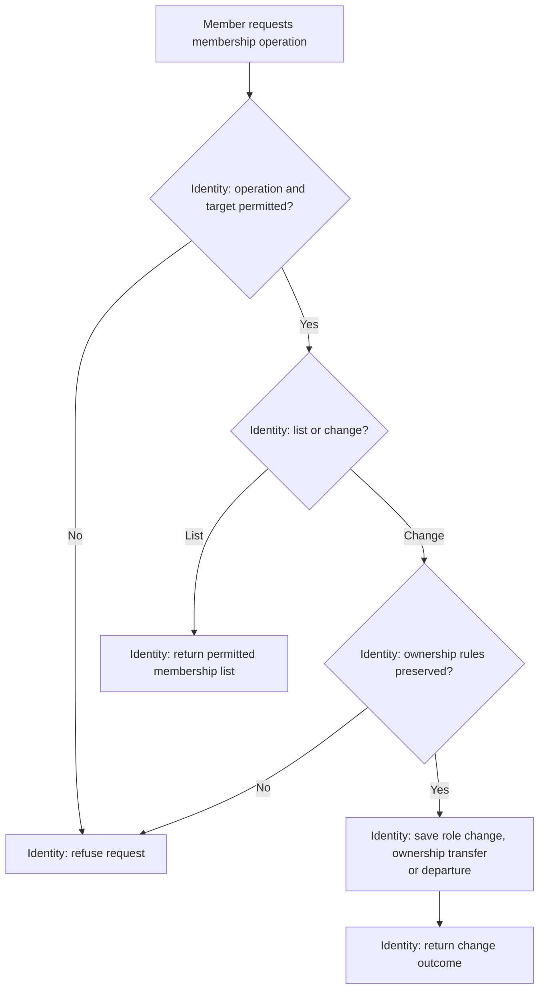

# Membership and Ownership

**Purpose:** Manage roles, transfer ownership or leave an organization.

Owner: `list_memberships`, `update_membership`, `transfer_ownership`. Member: `leave_organization`.

## Steps

The [ownership rules](../problem_statement.md#access-and-privacy) apply to every change. Recruiter removal has its [own workflow](remove-recruiter.md).

## Failure and Recovery

- Concurrent role changes or departures must not remove the last owner.
- An unsuccessful change leaves existing roles intact. Retrying a transfer must not overwrite a later ownership change.

[Workflow index and shared execution rules](README.md)
