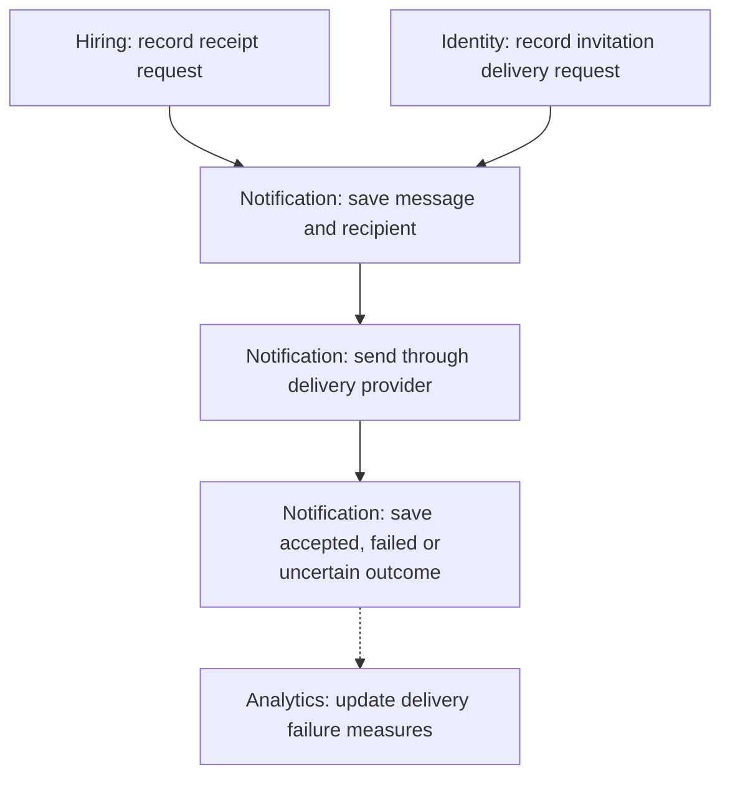

# Notification Delivery

**Purpose:** Deliver application receipts and organization invitations.

Automatic work: Hiring requests receipts; Identity requests invitations. Notification owns delivery.

## Steps

## Failure and Recovery

- Provider acceptance does not prove recipient receipt. Delivery failure leaves the application or invitation unchanged.
- Retry confirmed temporary failures. Reconcile uncertain outcomes before resending because a timeout may follow a successful send.
- Provider deduplication and status-query capabilities remain to be selected; unresolved outcomes may need investigation.

[Workflow index and shared execution rules](README.md)
