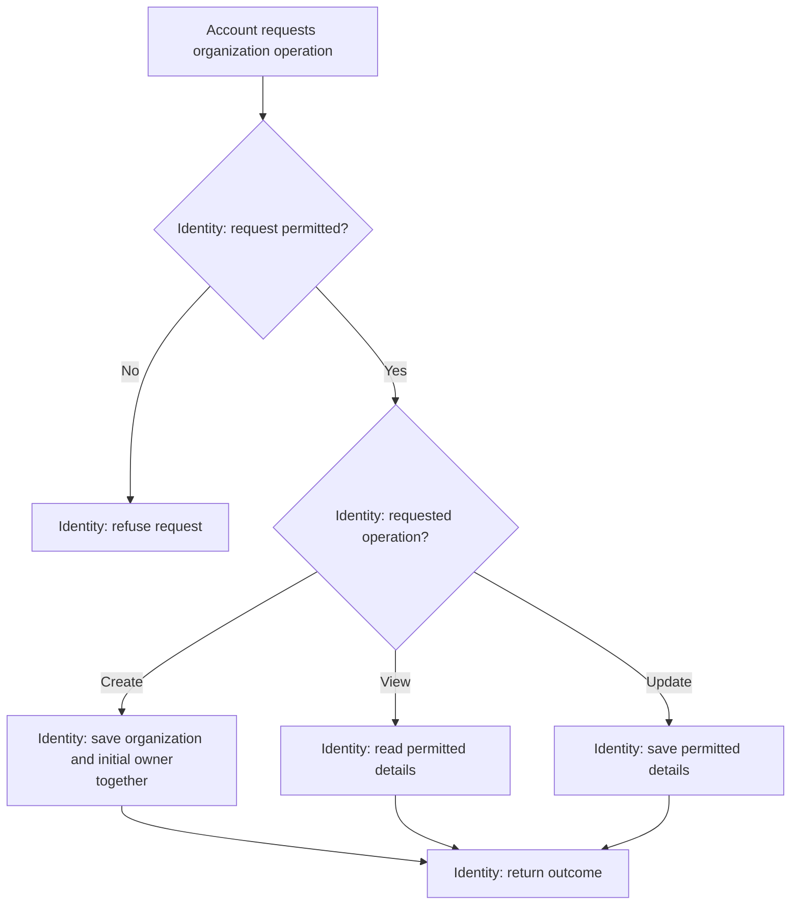

# Organization Management

**Purpose:** Create an organization and maintain its details.

Account: `create_organization`. Member: `view_organization`. Owner: `update_organization`.

## Steps

Identity checks account access for creation, membership for viewing and owner access for updates.

## Failure and Recovery

- Never confirm creation without a durable initial owner membership.
- Recover the original creation outcome after a timeout; do not create another organization.

[Workflow index and shared execution rules](README.md)
