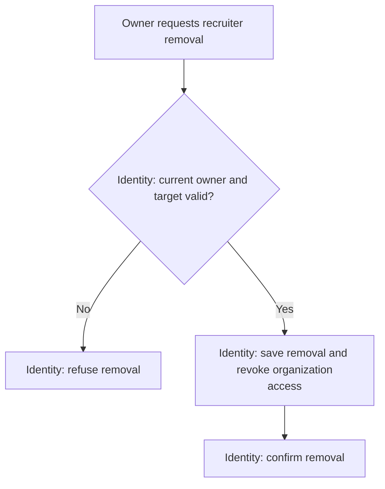

# Remove a Recruiter

**Purpose:** Revoke one organization's recruiter access.

Owner: `remove_recruiter`.

## Steps

The [access rules](../problem_statement.md#access-and-privacy) define what remains available to the account. [ADR 0003](../../adrs/0003-authentication-and-sessions.md) defines live Identity checks; enforcement for in-progress operations remains open.

## Failure and Recovery

- If the removal response is lost, recover its outcome from current membership state.
- Current-access checks at request entry do not settle races with later writes. Enforcement for in-progress operations remains open.
- A previously completed authorized change remains recorded. A change must not complete using access already removed.

[Workflow index and shared execution rules](README.md)
