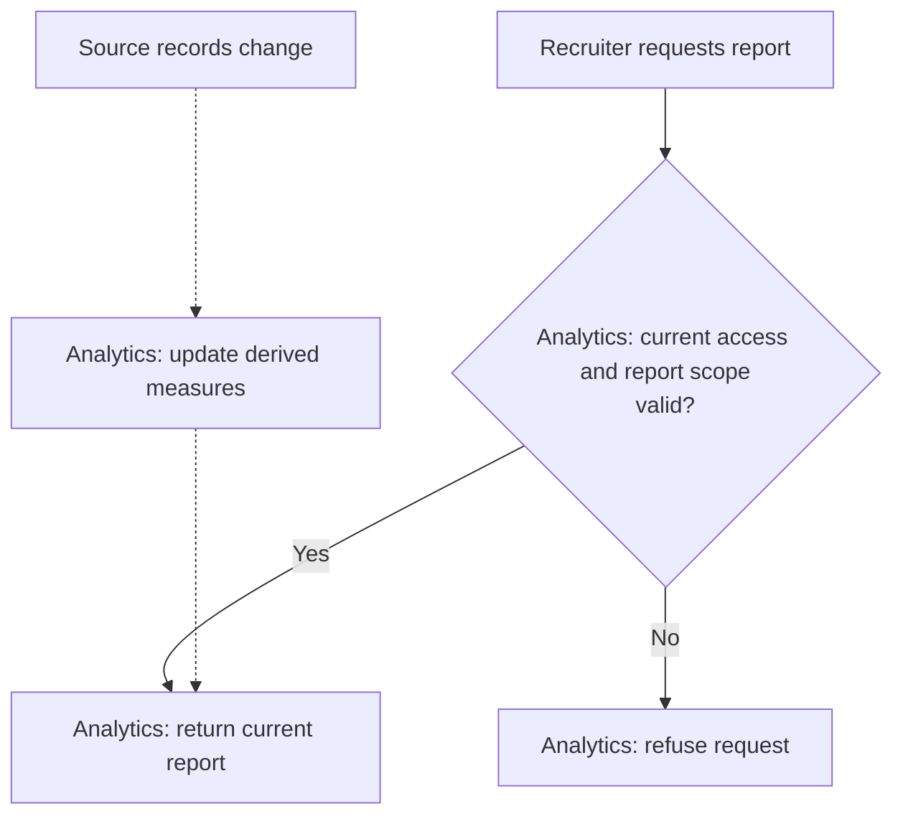

# Hiring Reports

**Purpose:** Update derived measures and return permitted organization reports.

Recruiter or owner: `report_hiring_metrics`. Source changes update reports independently.

## Steps

The [requirements](../problem_statement.md#required-reports) define the measures and dashboard refresh interval.
Source owners are listed in the [interaction map](../../adrs/0002-service-boundaries.md#service-interactions).

## Failure and Recovery

- Save reporting progress with metric changes. Resume or reconcile missing source changes without counting them twice.
- Reporting failures leave source records unchanged. Old reporting data must not restore removed access.
- Report reads do not trigger recomputation. A new job revision must not count as another job.

[Workflow index and shared execution rules](README.md)
